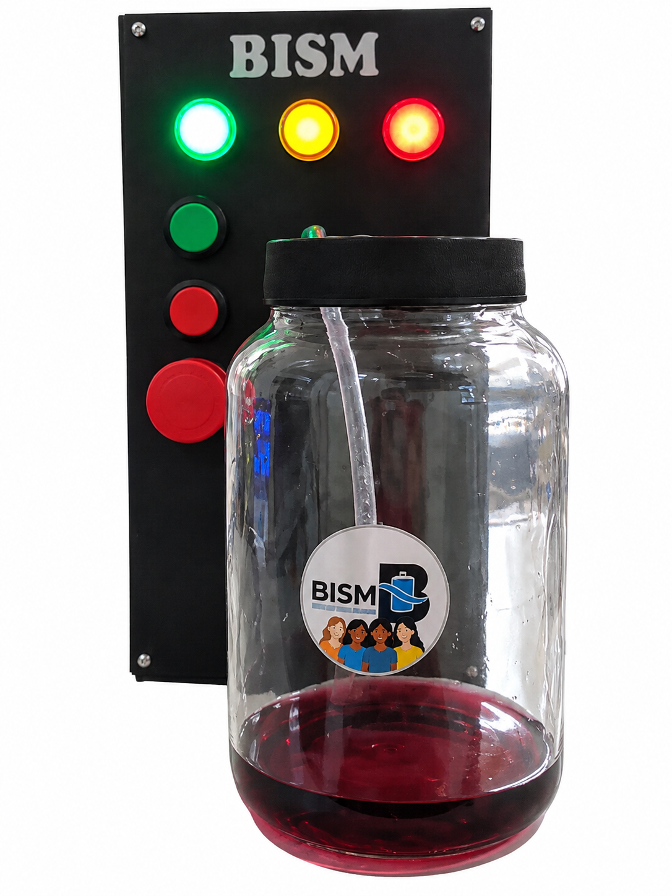
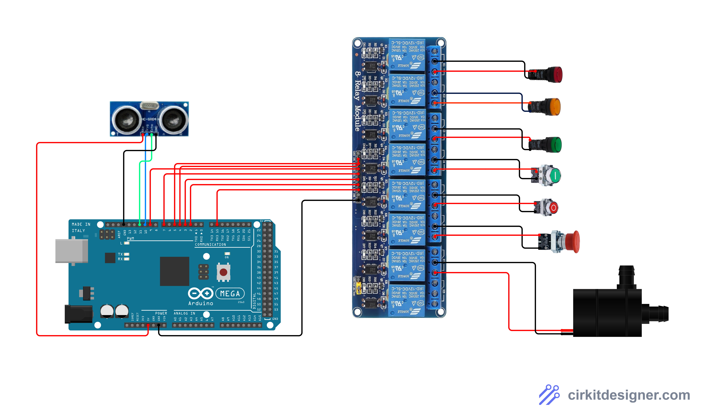

# Sistema de Monitoramento e Controle de Nível de Tanque (BISM)

Protótipo desenvolvido para automação, monitoramento de nível e transferência de líquidos. O sistema utiliza um **Arduino Mega 2560**, um **sensor ultrassônico (HC-SR04)** e um **módulo relé de 8 canais** para gerenciar o bombeamento de líquido de um reservatório interno para um recipiente externo (como um jarro ou tanque de destino), oferecendo sinalização visual por sinaleiros LED e botões industriais de comando e parada de emergência.

---

## Visão Geral do Projeto

> 

### Como funciona na prática
Dentro do gabinete principal existe um **mini tanque reservatório** cujo nível é monitorado continuamente pelo sensor ultrassônico posicionado na parte superior:

* **Transferência de líquido:** Enquanto há líquido suficiente no reservatório interno, a bomba d'água permanece acionada, enviando o líquido através da mangueira para o jarro (ou recipiente externo).
* **Proteção contra funcionamento a seco (Nível Baixo):** Quando o nível do reservatório interno baixa a ponto de a distância até o sensor ficar **igual ou superior a $20\text{ cm}$**, o sistema aciona o **sinaleiro vermelho** e **desliga imediatamente a bomba d'água**, interrompendo o envio de líquido para o recipiente externo.
* **Sinalização de estado:** Os três sinaleiros no topo do painel (Verde, Amarelo e Vermelho) indicam visualmente a faixa de nível do reservatório interno em tempo real.
* **Comandos físicos:** O painel conta com botão **Liga** (verde), botão **Desliga** (vermelho) e **Botão de Emergência** (cogumelo vermelho), que interrompe todo o processo instantaneamente.

---

## Lógica de Operação e Faixas de Nível

O cálculo da distância entre o sensor e a superfície do líquido é feito pela fórmula:

$$\text{Distância (cm)} = \frac{\text{Duração do Pulso ($\mu$s)} \times 0.0343}{2}$$

Com base na leitura, o sistema atua nas seguintes faixas:

| Distância medida ($d$) | Nível do Reservatório Interno | Sinaleiro Verde | Sinaleiro Amarelo | Sinaleiro Vermelho | Bomba d'Água |
| :--- | :--- | :---: | :---: | :---: | :---: |
| $d \ge 20\text{ cm}$ | **Nível Baixo / Crítico** | Desligado | Desligado | **Ligado** | **Desligada** |
| $6\text{ cm} < d < 20\text{ cm}$ | **Nível Médio / Operacional** | Desligado | **Ligado** | Desligado | **Ligada** |
| $d \le 6\text{ cm}$ | **Nível Alto / Cheio** | **Ligado** | Desligado | Desligado | **Ligada** |

> **Nota de Segurança:** Caso o botão de **Emergência** seja pressionado ou o botão **Desliga** seja acionado, a bomba é imediatamente desenergizada (`HIGH` no relé ativo em nível baixo) e o sistema entra em estado de espera até ser rearmado.

---

## Diagrama do Circuito e Pinagem

> 

### Lista de Componentes (Hardware)
* **Microcontrolador:** Arduino Mega 2560
* **Sensor de Nível:** Sensor Ultrassônico HC-SR04
* **Atuação / Isolação:** Módulo Relé 12V de 8 Canais (lógica *active-low*)
* **Sinalização:** 3 Sinaleiros LED (Verde, Amarelo e Vermelho)
* **Botoeiras:** 1 Botão NA (Liga), 1 Botão NF/NA (Desliga) e 1 Botão Cogumelo (Parada de Emergência)
* **Atuador Hidráulico:** Mini Bomba d'Água Submersa / Externa

### Mapeamento de Pinos (Arduino Mega 2560)

| Componente / Sinal | Pino no Arduino | Canal no Módulo Relé | Tipo de Sinal |
| :--- | :---: | :---: | :--- |
| Sensor Ultrassônico (`TRIG`) | `D10` | — | Saída Digital |
| Sensor Ultrassônico (`ECHO`) | `D11` | — | Entrada Digital |
| Sinaleiro Vermelho | `D4` | `IN1` (`K1`) | Saída Digital |
| Sinaleiro Amarelo | `D5` | `IN2` (`K2`) | Saída Digital |
| Sinaleiro Verde | `D9` | `IN3` (`K3`) | Saída Digital |
| Circuito Botão Liga (`START`) | `D7` | `IN4` (`K4`) | Entrada (`INPUT_PULLUP`) |
| Circuito Botão Desliga (`STOP`) | `D3` | `IN5` (`K5`) | Entrada (`INPUT_PULLUP`) |
| Circuito Botão Emergência (`E-STOP`) | `D2` | `IN6` (`K6`) | Entrada (`INPUT_PULLUP`) |
| Bomba d'Água | `D15` | `IN7` (`K7`) | Saída Digital |

---

## Como Executar e Monitorar

1. **Montagem:** Conecte o sensor ultrassônico, o módulo relé, os sinaleiros, os botões e a alimentação externa da bomba conforme o diagrama elétrico.
2. **Upload do Código:** Abra o arquivo `tank_level_controller.cpp` na **Arduino IDE** (ou PlatformIO), selecione a placa **Arduino Mega or Mega 2560** e faça o upload.
3. **Monitor Serial:** Abra o Monitor Serial configurado em **`9600 baud`** para acompanhar as leituras em tempo real:
   * `System OFF` — Sistema aguardando o pressionamento do botão **Liga**.
   * `Distance: XX.XX cm` — Sistema ativo exibindo a distância atual até a superfície do líquido.
   * `EMERGENCY STOP!` — Parada de emergência acionada.

---

## Observações Técnicas de Montagem

Antes de energizar o sistema em bancada ou campo, certifique-se de verificar os seguintes pontos físicos no chicote elétrico:
* **Alimentação do Módulo Relé:** Garanta que o `GND` do módulo relé esteja interligado ao `GND` do Arduino Mega (referência comum) e que o `VCC`/`JD-VCC` receba a tensão adequada das bobinas (12V/5V conforme o jumper da placa).
* **Leitura das Botoeiras:** Como o firmware utiliza `INPUT_PULLUP` nos pinos `D2`, `D3` e `D7`, os botões físicos devem fechar contato diretamente entre esses pinos digitais e o `GND` do Arduino (ou através de contatos secos isolados devidamente referenciados ao `GND`).
* **Alimentação da Bomba:** A bomba d'água deve ser alimentada por uma fonte externa compatível com sua corrente nominal, utilizando apenas os contatos `COM` e `NO` do canal `K7` como chaveamento.